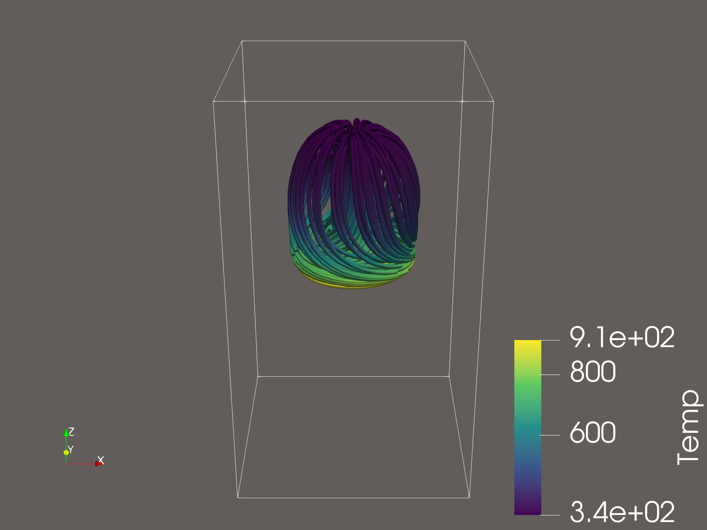

# Draw streamlines in ParaView

> **Status:** draft. Verified steps and screenshots to come.

Draw [streamlines](../../../../reference/glossary.md#streamline) through a simulated flow in ParaView, and color them by temperature.
**Time:** 10 minutes · **Program:** ParaView · **Also in:** [MATLAB](matlab.md)

| Before this | Data | You'll need |
|---|---|---|
| [Start ParaView on OnDemand](../../tools/paraview.md) | `disk_out_ref.ex2`: air around a heated, spinning disk. It comes with ParaView (BSD-3) | A running ParaView session |

> [!NOTE]
> **Cluster details.** <mark>Highlighted</mark> values are placeholders. Kitsune's queue names, module versions, paths, and addresses go in when the cluster is deployed.

## Why this matters

The practice data has a velocity vector at every mesh point. Arrows show a sample of them; streamlines connect the samples into curves, so you can see the dome of rising air over the heated disk instead of a scatter of arrows. The two filters used here work on any [vector field](../../../../reference/glossary.md#scalar-field-and-vector-field) ParaView can read.

## Key idea

Stream Tracer starts at a point you give it and integrates the velocity field from there until the curve leaves the data. Those points are the seeds, and they decide which part of the flow you see: a small cloud in the middle of the domain shows the middle of the flow and nothing about the corners. If a region looks empty, widen the seed cloud or move it before deciding the flow is quiet there. → [Glossary: streamline](../../../../reference/glossary.md#streamline)

## Steps

### Step 1: Open the data as an outline

Open `disk_out_ref.ex2` as in [the ParaView starter](../../tools/paraview.md) and click **Apply**. Then set the **Representation** drop-down on the toolbar from **Surface** to **Outline**.

**You should see:** a box outline, so you can see inside the flow domain.

Screenshot: the Representation drop-down set to Outline

*Screenshot to come.*

### Step 2: Add a stream tracer

Select `disk_out_ref.ex2` in the Pipeline Browser and choose **Filters ▸ Alphabetical ▸ Stream Tracer**. In **Properties**, set **Vectors** to `V`. Set **Seed Type** to **Point Cloud** and untick **Show Sphere**. Click **Apply**.

**You should see:** thin lines swirling through the domain, starting from a cloud of points near its middle.

Screenshot: Stream Tracer's properties with Vectors and Seed Type marked

*Screenshot to come.*

### Step 3: Make the lines visible

With **StreamTracer1** selected, choose **Filters ▸ Alphabetical ▸ Tube** and click **Apply**.

**You should see:** the lines become tubes, thick enough that you can tell which line is in front.

### Step 4: Color by temperature

With **Tube1** selected, choose **Temp** in the toolbar's coloring drop-down and click **Rescale to Data Range**. Choose the **Viridis** preset (see Step 5 of the starter).

**You should see:** tubes colored by the air's temperature: hot near the heated disk, cooler where fresh air enters.

What you should see

*Figure 1. Streamlines through `disk_out_ref.ex2`, colored by temperature with Viridis, drawn by the lesson's script. Yellow is the hottest air.*

### Step 5: Save the picture

Choose **File ▸ Save Screenshot…** and save to `~/scratch/streamlines.png` at 1600 by 1200.

**You should see:** the image in the **Files** app. To make the same picture without clicking, run [`scripts/streamlines.py`](../../scripts/streamlines.py) with `pvbatch`.

## Check your understanding

Your streamlines all bunch up in one corner and miss the region you care about. What do you change first?

The seeds. Enlarge the point cloud or move its center. Or switch **Seed Type** to **Line** and lay that line across the inflow, so every curve starts upstream of what you want to see.

Why color the streamlines by temperature instead of drawing them in one color?

The line shows where the air goes and the color shows how hot it is along the way. In a single color you could not tell which lines carry the heat.

## If something goes wrong

| What you see | Why | What to do |
|---|---|---|
| **Stream Tracer** makes nothing | **Vectors** isn't set to the velocity, or the seeds are outside the data | Set **Vectors** to `V`, and reset the seed position (the reset button next to the point-cloud settings) |
| Only a few short lines | The seed cloud is small, or the flow is slow near the seeds | Raise **Number Of Points** and **Radius** under the seed settings, then **Apply** |
| `Temp` and `V` aren't in the lists | Your ParaView shows variable names in lower case | Choose `temp` and `v` instead |

## Next

- [All versions of this lesson](README.md): the same picture in MATLAB, and what each program reads.
- [ParaView lessons](../../maps/paraview.md): the other ParaView lessons.
- [Draw streamlines in MATLAB](matlab.md): the same lesson with MATLAB's sample wind data.

## Credits

Data: `disk_out_ref.ex2`, ParaView example data (Kitware/Sandia), BSD-3-Clause.
